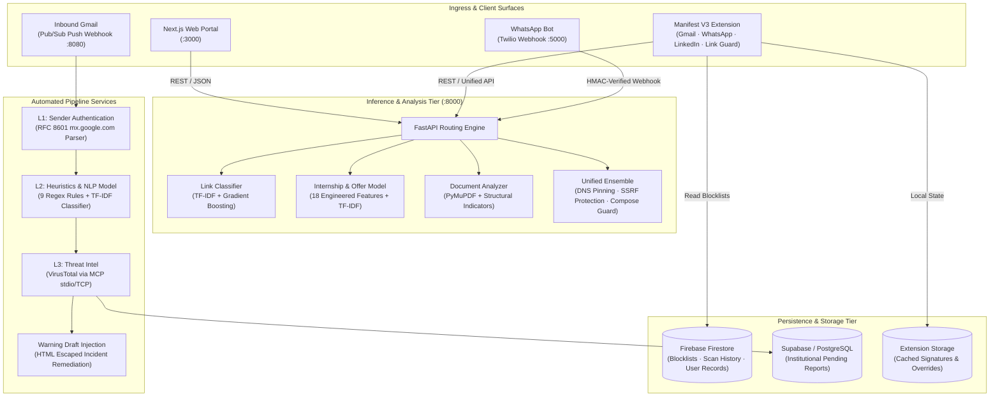

# PhishGuard

> Multi-surface scam detection and security intelligence platform for educational and student environments.

PhishGuard is an end-to-end security system engineered to detect, intercept, and analyze targeted cyber threats—specifically phishing campaigns, fraudulent internship offers, credential harvesting, and malicious links across email, browser, and messaging surfaces.

Unlike generic corporate email gateways, PhishGuard is optimized for the threat models targeting students and academic institutions, including unverified recruiter outreach, student portal impersonation, fee-demanding internship scams, and cross-platform attacks originating on WhatsApp, LinkedIn, or personal Gmail.

---

## Architecture Overview

PhishGuard operates across four layers: a client-side scanning web application, an ML inference backend, an active browser security extension, and asynchronous background ingestion pipelines for institutional Gmail and WhatsApp channels.



---

## Repository Structure

```text
PhishGuard-Major-Project/
├── phishguard/                  # Next.js 15 static-export web application
│   ├── app/                     # App router pages (email, link, doc, dashboard, etc.)
│   ├── components/              # Reusable UI component library (Tailwind CSS)
│   ├── lib/                     # Firebase initialization and shared client utilities
│   └── extension-build/         # Unpacked Manifest V3 Chrome Extension
│       ├── content-gmail.js     # Gmail threat banner & scan integration
│       ├── content-whatsapp.js  # WhatsApp Web recruiter offer analyzer
│       ├── content-linkedin.js  # LinkedIn inmail scam scanner
│       ├── content-link-guard.js# Network interstitial and navigation defense
│       └── background.js        # Service worker, DNR rules & Gemini fallback
│
├── mlmodel/                     # Python FastAPI inference service
│   ├── app/
│   │   ├── main.py              # Application entrypoint and router registration
│   │   ├── routers/             # Endpoint implementations (/scan/*)
│   │   ├── utils/               # PDF/DOCX extractors, text & domain preprocessors
│   │   └── models/              # Serialized scikit-learn models, vectorizers & metadata
│   ├── train/                   # Isolated model training pipelines
│   ├── datasets/                # Labeled training sets (emails, URLs, offer messages)
│   └── tests/                   # Automated regression and contract test suites
│
├── email/                       # Autonomous Gmail security and remediation pipeline
│   ├── main.py                  # Pub/Sub push listener, admin endpoints, SSE feed
│   ├── pipeline/                # L1 auth, L2 heuristics & NLP, L3 threat intel
│   ├── models/                  # Dedicated L2 TF-IDF + LogisticRegression NLP model
│   ├── frontend/                # React + Vite security operations dashboard
│   └── tests/                   # Security test suite (parser isolation, tokens, XSS checks)
│
├── whatsapp-bot/                # Node.js / Express Twilio integration
│   └── server.js                # Webhook listener with signature validation
│
└── test_documents/              # Corpus of validated phishing & legitimate sample files
```

---

## Core Subsystems

### 1. Web Portal (`phishguard/`)

Built with **Next.js 15 (App Router)** and **TypeScript**, configured for static export deployment on Firebase Hosting.

- Interactive scanners for suspicious URLs, raw email headers/text, and multi-format document uploads.
- Secure Firebase Authentication (Email/Password, Google OAuth).
- User scan history tracking and community incident reporting persisted to Cloud Firestore.
- Strict client-side validation with zero mock fallbacks on backend connectivity failures.

### 2. Machine Learning Service (`mlmodel/`)

High-throughput **FastAPI** backend serving five targeted classification engines:

| Endpoint | Target Surface | Model Architecture | Key Signals |
| --- | --- | --- | --- |
| `POST /scan/link/` | Suspicious URLs | `GradientBoostingClassifier` + TF-IDF | Tokenized URL components, entropy, path structure, risky TLDs |
| `POST /scan/doc/` | PDF, DOCX, TXT files | `RandomForestClassifier` + TF-IDF | 22 hand-engineered features (money demands, urgency, credential solicitations, suspicious domains) + whole-word lexical indicators |
| `POST /scan/offer/` | Internship & Job Offers | `LogisticRegression` + TF-IDF | 18 specialized signals: registration fee demands, urgency flags, WhatsApp-only redirection, unrealistic stipend promises |
| `POST /scan/email/` | Inbound emails | Offer Classification Ensemble | Optimized for academic threats; returns confidence on a normalized `0.0 - 1.0` scale |
| `POST /scan/unified/` | Extension client engine | Multi-model aggregator | Combines link, email, trusted-domain checks, and live scrape analysis with server-side DNS pinning |

### 3. Multi-Platform Browser Extension (`phishguard/extension-build/`)

A **Manifest V3** security extension providing in-situ inspection across high-risk communication channels:

- **Gmail Shield**: Injects warning banners and threat indicators into the Gmail DOM, flagging impersonation attempts and spoofed college domains.
- **WhatsApp Web & LinkedIn Scanners**: Real-time evaluation of incoming recruiter pitches, highlighting fee-demand patterns and fake job listings.
- **Link Guard**: Intercepts link navigation across arbitrary tabs against dynamic Declarative Net Request (DNR) rule sets, routing suspicious destinations to an isolated warning interstitial (`blocked.html`).
- **Cryptographic Security**: Eliminates static bypass URL parameters in favor of ephemeral single-use session tokens managed via `chrome.storage.local`.

### 4. Inbound Gmail Pipeline (`email/`)

An autonomous mail flow processor monitoring institutional Google Workspace mailboxes via **Google Cloud Pub/Sub** push notifications:

- **L1 Cryptographic Authentication**: Validates SPF, DKIM, and DMARC using an RFC 8601-compliant parser that strictly inspects trusted `mx.google.com` receiving headers.
- **L2 Heuristic & NLP Analysis**: Evaluates body content against 9 structural heuristic rules coupled with a dedicated TF-IDF semantic classifier.
- **L3 Model Context Protocol (MCP) Intelligence**: Queries VirusTotal via an external MCP bridge running under strict token-bucket rate limits.
- **Automated Thread Remediation**: Creates secure, HTML-escaped warning drafts inside affected conversation threads with a safe, tokenized admin reporting action.
- **SecOps Dashboard**: Real-time SSE streaming monitoring interface with server-side token authorization for review queues.

### 5. WhatsApp Threat Assistant (`whatsapp-bot/`)

A **Node.js / Express** microservice integrating with the Twilio Messaging API.

- Implements strict cryptographic HMAC-SHA1 validation on inbound webhooks.
- Routes suspicious student messages to `/scan/offer/` to generate immediate, plain-language risk breakdowns and defensive advice.

---

## Getting Started

### Prerequisites

- Node.js 18 LTS or higher
- Python 3.11+
- Git

### 1. Web Portal Setup

```bash
cd phishguard
npm install

# Build static bundle
npm run build

# Start local development server
npm run dev
# Portal accessible at http://localhost:3000
```

### 2. Machine Learning API Setup

```bash
cd mlmodel

# Initialize virtual environment
python -m venv venv
source venv/bin/activate  # On Windows: venv\Scripts\activate

# Install dependencies (scikit-learn is pinned to 1.8.0)
pip install -r requirements.txt

# Run test suite
python -m pytest tests

# Start API server
uvicorn app.main:app --reload --host 127.0.0.1 --port 8000
# OpenAPI documentation available at http://127.0.0.1:8000/docs
```

### 3. Chrome Extension Installation

1. Open Google Chrome and navigate to `chrome://extensions/`.
2. Enable **Developer mode** in the top-right corner.
3. Click **Load unpacked** and select the directory:
   `c:\Work\PhishGuard-Major-Project\phishguard\extension-build`
4. (Optional) For Gemini capabilities, create a local file `extension-build/gemini-config.local.js`:

   ```javascript
   GEMINI_CONFIG.apiKey = "YOUR_GEMINI_API_KEY";
   ```

### 4. Gmail Pipeline Setup (Optional)

```bash
cd email
python -m venv venv
source venv/bin/activate
pip install -r requirements.txt

# Run security test suite
python -m pytest tests

# Start service
uvicorn main:app --reload --port 8080
```

### 5. WhatsApp Bot Setup (Optional)

```bash
cd whatsapp-bot
npm install

# Start webhook server
node server.js
```

---

## API Reference

### Link Scanner

```http
POST /scan/link/
Content-Type: application/json

{
  "url": "http://secure-login-verify.tk/account"
}
```

**Response (200 OK):**

```json
{
  "prediction": "Phishing",
  "confidence": 0.965
}
```

### Document Scanner

```http
POST /scan/doc/
Content-Type: multipart/form-data

file=@offer_letter.pdf
```

**Response (200 OK):**

```json
{
  "prediction": "Phishing/Fake",
  "confidence": 0.792,
  "risk_score": 100,
  "risk_level": "HIGH",
  "verdict": "This document appears to be a phishing attempt or fraudulent document.",
  "warnings": [
    "Contains suspicious URLs: http://internship-confirm.tk/verify",
    "Requests sensitive information: aadhaar, bank account",
    "Money-related language: fee, pay"
  ],
  "indicators": {
    "urgency": ["within 24 hours"],
    "money": ["fee", "pay", "rs"],
    "credentials": ["aadhaar", "bank account"],
    "threats": [],
    "suspicious_urls": ["http://internship-confirm.tk/verify"],
    "actions": ["click here", "pay now"]
  }
}
```

### Job / Internship Offer Scanner

```http
POST /scan/offer/
Content-Type: application/json

{
  "message": "Congratulations! Selected for Web Intern. Deposit Rs 1999 registration fee via UPI within 2 hours."
}
```

**Response (200 OK):**

```json
{
  "is_offer": true,
  "prediction": "Fake",
  "confidence": 99.0,
  "red_flags": [
    "Payment or fee demanded from candidate",
    "Urgency/pressure language used"
  ]
}
```

### Unified Risk Scan

```http
POST /scan/unified/
Content-Type: application/json

{
  "email_text": "Verify your institutional credentials immediately.",
  "sender_domain": "college-admin.com",
  "url": "https://portal-verify.tk",
  "trusted_domains": ["nmamit.in", "nitte.edu.in"]
}
```

**Response (200 OK):**

```json
{
  "event_id": "9bee53ad-dd03-4a23-84ad-3df39fa6aa2b",
  "risk_score": 100,
  "risk_level": "HIGH",
  "recommendation": "block_or_step_up",
  "explanations": [
    "urgency: immediately",
    "credential request: verify your account",
    "url uses social-engineering style domain tokens"
  ],
  "signals": {
    "email": {
      "prediction": "Fake",
      "confidence": 0.955,
      "risk_score": 96
    },
    "link": {
      "prediction": "Phishing",
      "confidence": 1.0,
      "risk_score": 100
    }
  }
}
```

---

## Configuration & Environment Variables

| Variable | Module | Required | Description |
| --- | --- | --- | --- |
| `NEXT_PUBLIC_API_URL` | `phishguard` | No | Base URL for FastAPI backend (default: `http://localhost:8000`) |
| `FEEDBACK_LOG` | `mlmodel` | No | Path to write runtime unified feedback JSONL log |
| `PUBSUB_VERIFICATION_TOKEN` | `email` | Yes* | Shared secret required in `/webhook/gmail?token=...` parameter |
| `DASHBOARD_TOKEN` | `email` | Yes* | Authorization token for SecOps admin endpoints and `/api/stream` |
| `PUBLIC_BASE_URL` | `email` | Yes* | Publicly accessible domain for email report button links |
| `VIRUSTOTAL_API_KEY` | `email` | Yes* | VirusTotal API key for L3 threat intelligence lookup |
| `TWILIO_ACCOUNT_SID` | `whatsapp-bot` | Yes* | Twilio service account SID |
| `TWILIO_AUTH_TOKEN` | `whatsapp-bot` | Yes* | Twilio API authentication token |
| `PUBLIC_WEBHOOK_URL` | `whatsapp-bot` | Yes* | Full public URL of `/webhook` used to verify Twilio request signatures |

*\*Required only when running the respective background services.*

---

## Security Engineering

PhishGuard incorporates defense-in-depth principles across its code and architecture:

1. **SSRF Mitigation with DNS Pinning**: The URL intelligence engine (`/scan/unified/url-intel`) performs resolution validation before connecting. If a hostname resolves to any private, loopback, or non-global IP, the request is aborted. Connections are made directly to the validated IP while retaining TLS host validation to neutralize DNS-rebinding attacks.
2. **RFC 8601 Header Hardening**: The Gmail pipeline strictly reads the topmost `Authentication-Results` header bearing the `mx.google.com` authserv identifier. Injected or forged downstream headers embedded within email bodies are rejected.
3. **Owner-Only Credential Isolation**: Google OAuth tokens on disk are written with restrictive `0600` POSIX file permissions.
4. **Context-Aware HTML Escaping**: Warning draft composers and extension DOM injectors sanitize all raw message bodies and URL parameters prior to innerHTML injection to eliminate XSS vectors.
5. **Session-Level Interstitial Bypasses**: The extension link guard replaces static bypass query parameters with short-lived (60s) single-use tokens stored in isolated extension memory.

---

## Verification & Testing

Every component includes regression and contract tests:

```bash
# 1. Machine Learning Backend Tests (14 passed)
cd mlmodel
python -m pytest tests

# 2. Gmail Security & Parser Tests (10 passed)
cd ../email
python -m pytest tests

# 3. SecOps Dashboard Verification
cd ../email/frontend
npm run lint
npm run build

# 4. Web Portal Static Build & Linting
cd ../../phishguard
npm run lint
npm run build
```

---

## License

This project is licensed under the MIT License. See [LICENSE](LICENSE) for details.
